# Ceylon Future Beverages — Company Profile

> Source: `Ceylon Future Beverages Company Profile.pdf` (23 pages, landscape).
> Each section below matches one PDF page; the rendered page image is linked under its heading
> (`company-profile/page-NN.jpg`). Text is transcribed verbatim, including the original spelling.
> The "Page No" footers printed on some pages don't follow the PDF order; they are noted where present.
>
> Running footer on pages 2, 3, 9–12: `www.ceylonfuturebeverages.com` · `Ceylon Future Beverages Product Profile` · `Page No NN`

---

## Page 1 — Cover

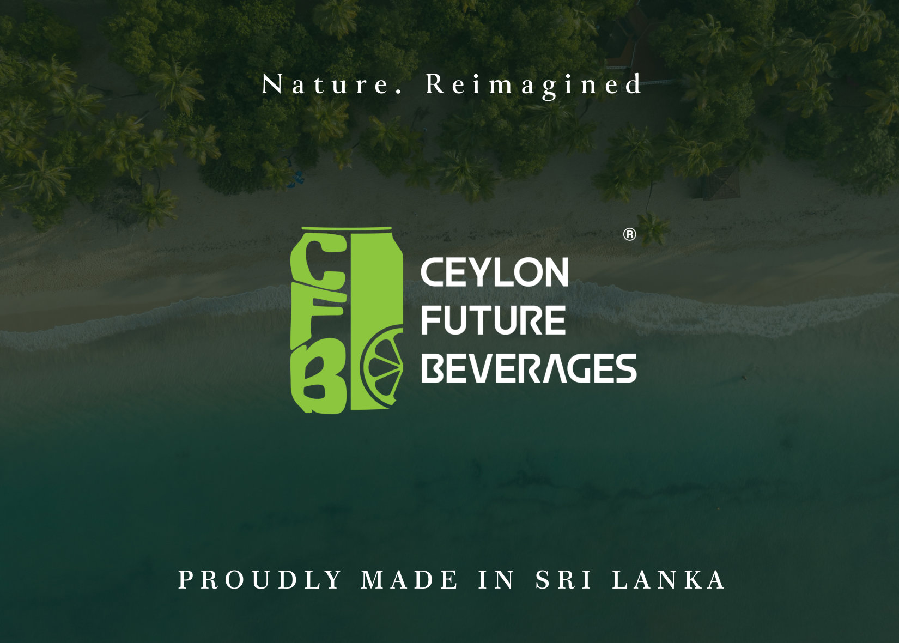

**Nature. Reimagined**

CFB logo: **CEYLON FUTURE BEVERAGES**®

**PROUDLY MADE IN SRI LANKA**

---

## Page 2 — Vision, Mission, Core Values & Company Details

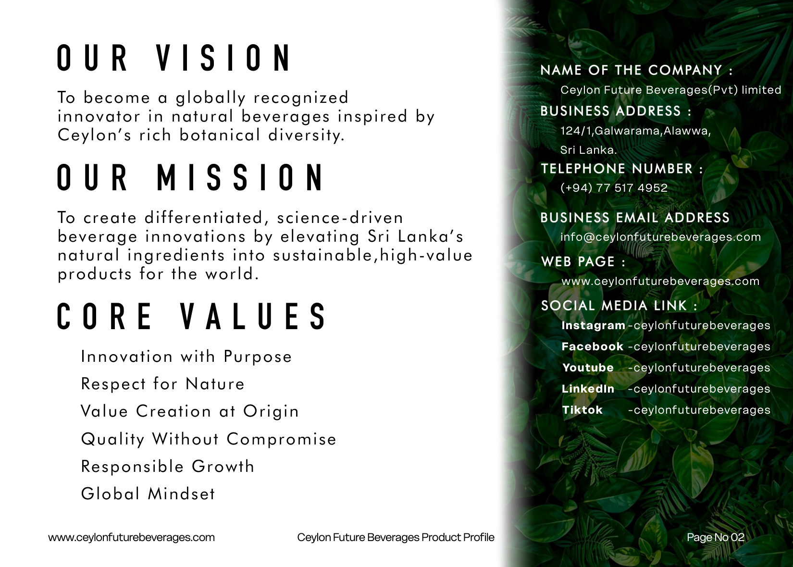

### Our Vision

To become a globally recognized innovator in natural beverages inspired by Ceylon's rich botanical diversity.

### Our Mission

To create differentiated, science-driven beverage innovations by elevating Sri Lanka's natural ingredients into sustainable, high-value products for the world.

### Core Values

- Innovation with Purpose
- Respect for Nature
- Value Creation at Origin
- Quality Without Compromise
- Responsible Growth
- Global Mindset

### Company Details

| Field | Value |
| --- | --- |
| Name of the company | Ceylon Future Beverages (Pvt) Limited |
| Business address | 124/1, Galwarama, Alawwa, Sri Lanka. |
| Telephone number | (+94) 77 517 4952 |
| Business email address | info@ceylonfuturebeverages.com |
| Web page | www.ceylonfuturebeverages.com |

**Social media links**

| Platform | Handle |
| --- | --- |
| Instagram | ceylonfuturebeverages |
| Facebook | ceylonfuturebeverages |
| YouTube | ceylonfuturebeverages |
| LinkedIn | ceylonfuturebeverages |
| TikTok | ceylonfuturebeverages |

*Footer: Page No 02*

---

## Page 3 — About Us

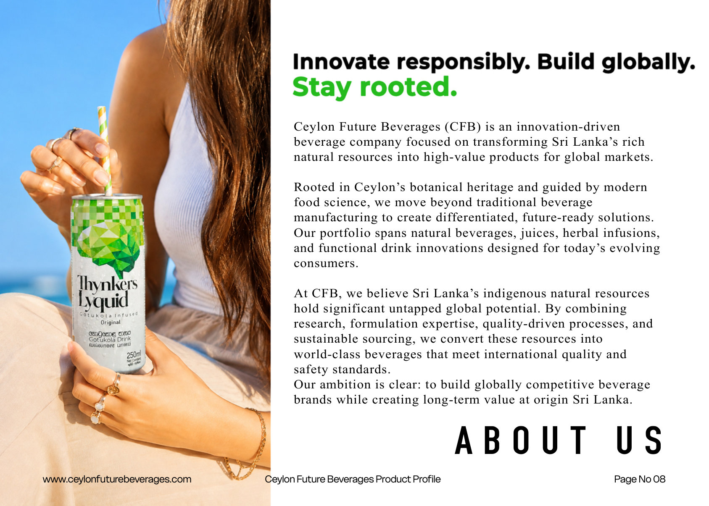

**Innovate responsibly. Build globally. Stay rooted.**

Ceylon Future Beverages (CFB) is an innovation-driven beverage company focused on transforming Sri Lanka's rich natural resources into high-value products for global markets.

Rooted in Ceylon's botanical heritage and guided by modern food science, we move beyond traditional beverage manufacturing to create differentiated, future-ready solutions. Our portfolio spans natural beverages, juices, herbal infusions, and functional drink innovations designed for today's evolving consumers.

At CFB, we believe Sri Lanka's indigenous natural resources hold significant untapped global potential. By combining research, formulation expertise, quality-driven processes, and sustainable sourcing, we convert these resources into world-class beverages that meet international quality and safety standards.

Our ambition is clear: to build globally competitive beverage brands while creating long-term value at origin Sri Lanka.

### ABOUT US

*Image: a woman holding a Thynkers Lyquid Original 250ml can with a straw, beach background.*

*Footer: Page No 08*

---

## Page 4 — What We Do / Why We Exist / How We Win

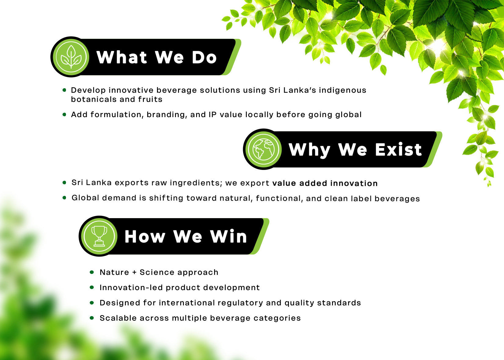

### What We Do

- Develop innovative beverage solutions using Sri Lanka's indigenous botanicals and fruits
- Add formulation, branding, and IP value locally before going global

### Why We Exist

- Sri Lanka exports raw ingredients; we export **value added innovation**
- Global demand is shifting toward natural, functional, and clean label beverages

### How We Win

- Nature + Science approach
- Innovation-led product development
- Designed for international regulatory and quality standards
- Scalable across multiple beverage categories

---

## Page 5 — Brand Architecture

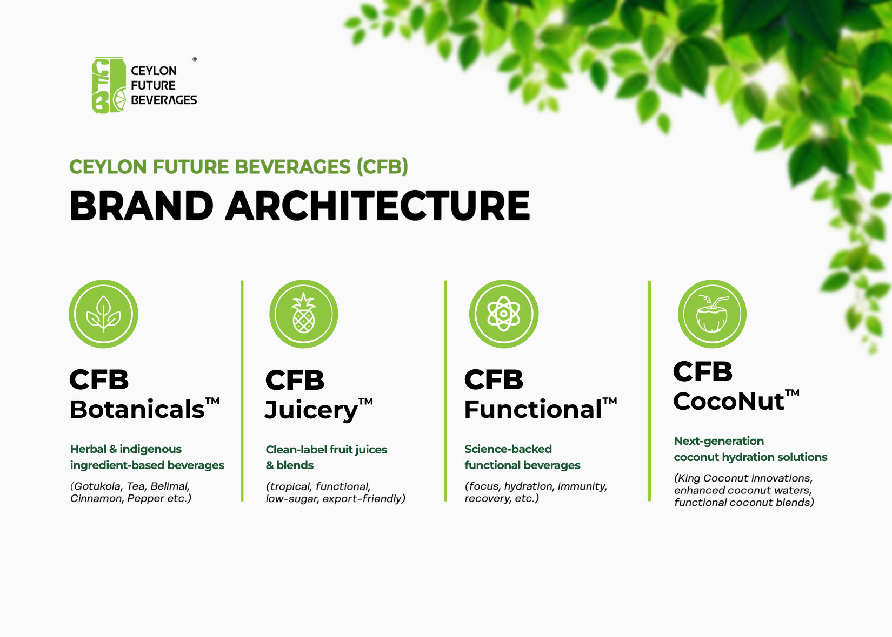

**CEYLON FUTURE BEVERAGES (CFB)**

### Brand Architecture

| Brand | Focus | Examples |
| --- | --- | --- |
| **CFB Botanicals™** | Herbal & indigenous ingredient-based beverages | Gotukola, Tea, Belimal, Cinnamon, Pepper etc. |
| **CFB Juicery™** | Clean-label fruit juices & blends | tropical, functional, low-sugar, export-friendly |
| **CFB Functional™** | Science-backed functional beverages | focus, hydration, immunity, recovery, etc. |
| **CFB CocoNut™** | Next-generation coconut hydration solutions | King Coconut innovations, enhanced coconut waters, functional coconut blends |

---

## Page 6 — Founder

### Suresh Jayarathna

Founder | Ceylon Future Beverages (Pvt) Ltd
BSc (Hons), MBA (UK)

Suresh Jayarathna is a Sri Lankan entrepreneur, technology professional and business strategist with a multidisciplinary background spanning Statistics, Operations Research, Business Management, Digital Transformation and Consumer Product Innovation.

He holds a BSc (Hons) in Statistics and Operations Research and an MBA, providing him with a strong foundation in analytical thinking, business strategy, data-driven decision-making and organizational management.

Before entering entrepreneurship, Suresh built his professional career in the technology and digital transformation field, working with one of Sri Lanka's largest apparel manufacturing organisations. In this role, he was involved in driving digital transformation and technology-led business initiatives, gaining valuable experience in automation, process optimisation, emerging technologies and the application of technology to solve complex business challenges.

Combining his technology expertise with his entrepreneurial ambition, Suresh identified an opportunity to create innovative consumer products by leveraging Sri Lanka's rich agricultural and natural resources. This vision led to the establishment of Ceylon Future Beverages (Pvt) Ltd, with a focus on developing modern, natural and functional beverages for both local and international markets.

Under his leadership, the company is developing a portfolio of innovative beverages that brings together Sri Lankan natural ingredients, modern beverage technology and contemporary consumer preferences.

Suresh's approach to entrepreneurship is driven by innovation, data, technology and product differentiation, with a strong emphasis on transforming locally available resources into higher-value products with international market potential.

With a unique combination of corporate technology experience, analytical expertise, business education and entrepreneurial vision, Suresh is committed to building innovative brands from Sri Lanka and taking them to the world.

His vision is to transform Sri Lanka's natural resources into innovative, globally competitive consumer products through technology, entrepreneurship and value addition.

---

## Page 7 — Board of Directors

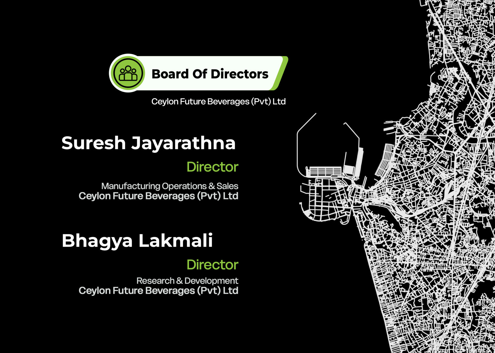

### Board Of Directors — Ceylon Future Beverages (Pvt) Ltd

| Name | Role | Area |
| --- | --- | --- |
| **Suresh Jayarathna** | Director | Manufacturing Operations & Sales, Ceylon Future Beverages (Pvt) Ltd |
| **Bhagya Lakmali** | Director | Research & Development, Ceylon Future Beverages (Pvt) Ltd |

---

## Page 8 — Tagline

**Innovate Responsibly.
Build Globally.
Stay Rooted.**

*Illustration: line-art skyline of Sri Lankan landmarks (lighthouse, stupa, Lotus Tower, Sigiriya, temples, clock tower, the national flag, a cable-stayed bridge).*

---

## Page 9 — Thynkers Lyquid

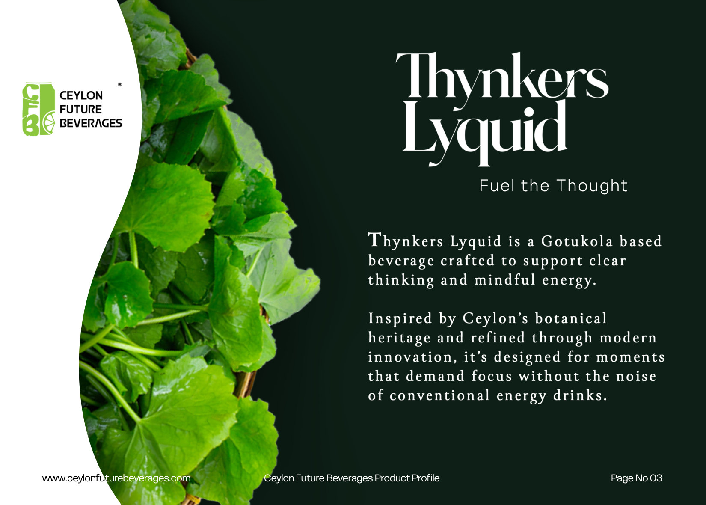

# Thynkers Lyquid

*Fuel the Thought*

Thynkers Lyquid is a Gotukola based beverage crafted to support clear thinking and mindful energy.

Inspired by Ceylon's botanical heritage and refined through modern innovation, it's designed for moments that demand focus without the noise of conventional energy drinks.

*Footer: Page No 03*

---

## Product pages (Pages 10–12)

All three flavours share these label claims:

- **Natural GOTUKOLA EXTRACT** (*Centella asiatica*)
- **12 MONTHS** shelf life
- **NO⁺ PRESERVATIVES**
- **NO⁺ ARTIFICIAL COLORS**
- **LOW SUGUR** *(spelling as printed)*
- **250ml ℮**
- Can text: *Thynkers Lyquid · Gotukola Infused · ගොටුකොළ පානය · Gotukola Drink · வல்லாரை பானம் · 250ml Net Content*

Nutrition panel (identical on all three pages, per can as printed):

| Energy | Fat | Saturated Fat | Sugars | Salt |
| --- | --- | --- | --- | --- |
| 75 kcal | 0 g | 0 g | 17.75 g | 0 g |

### Page 10 — Matcha

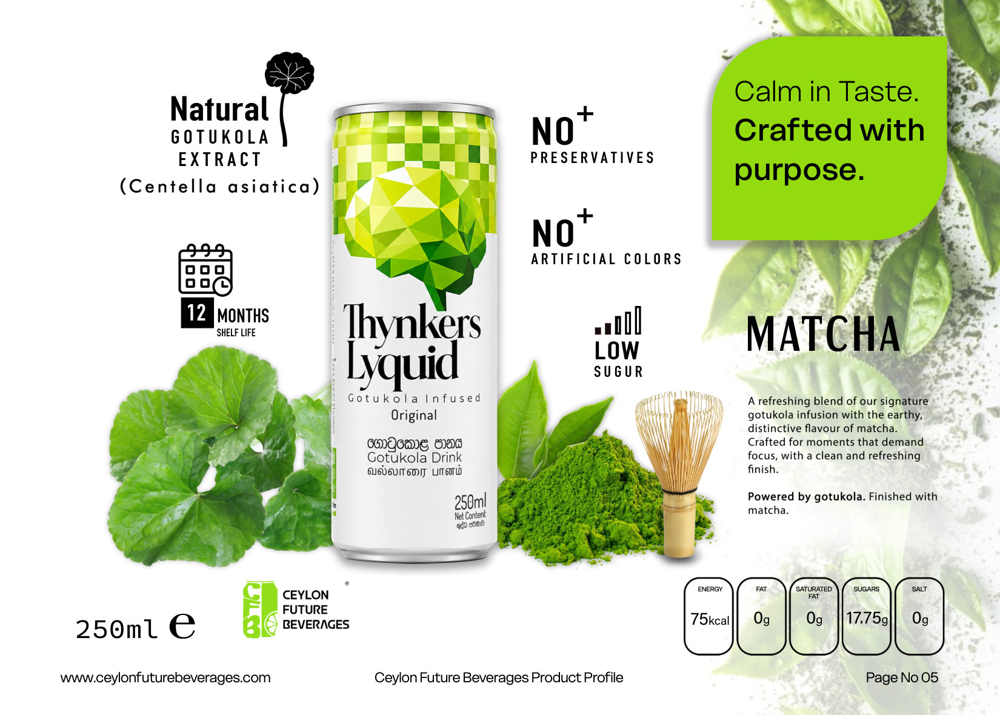

**Calm in Taste. Crafted with purpose.**

**MATCHA** (can label: *Original*)

A refreshing blend of our signature gotukola infusion with the earthy, distinctive flavour of matcha. Crafted for moments that demand focus, with a clean and refreshing finish.

**Powered by gotukola.** Finished with matcha.

*Footer: Page No 05*

### Page 11 — Mango & Passion

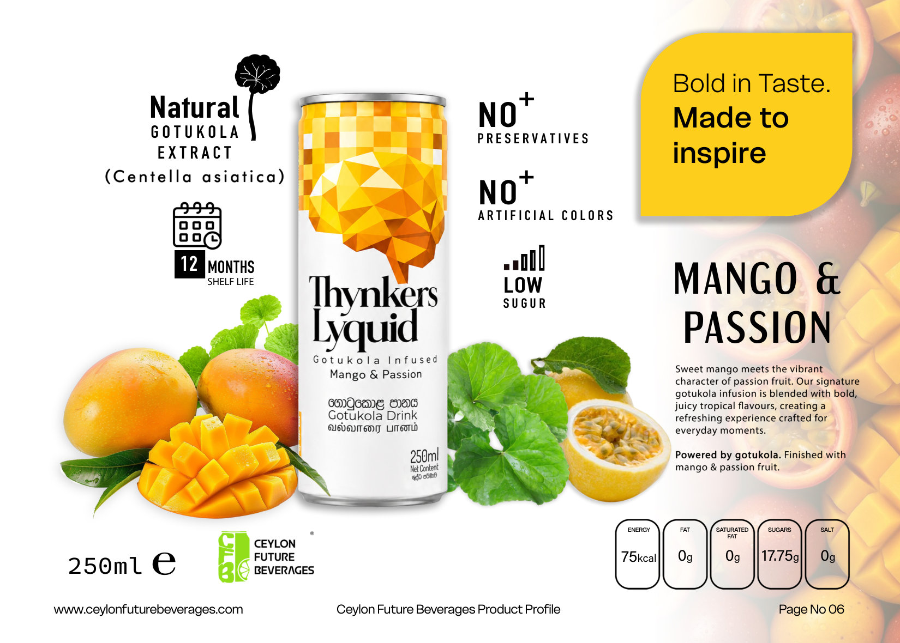

**Bold in Taste. Made to inspire**

**MANGO & PASSION**

Sweet mango meets the vibrant character of passion fruit. Our signature gotukola infusion is blended with bold, juicy tropical flavours, creating a refreshing experience crafted for everyday moments.

**Powered by gotukola.** Finished with mango & passion fruit.

*Footer: Page No 06*

### Page 12 — Pineapple

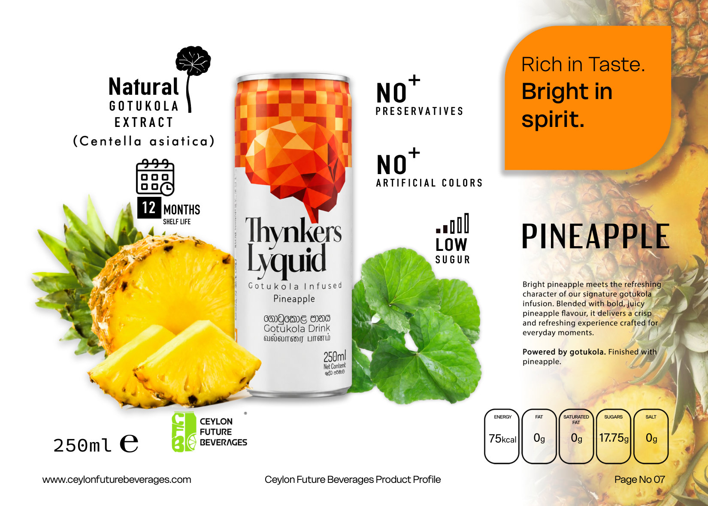

**Rich in Taste. Bright in spirit.**

**PINEAPPLE**

Bright pineapple meets the refreshing character of our signature gotukola infusion. Blended with bold, juicy pineapple flavour, it delivers a crisp and refreshing experience crafted for everyday moments.

**Powered by gotukola.** Finished with pineapple.

*Footer: Page No 07*

---

## Page 13 — Surprising Health Benefits of Gotukola

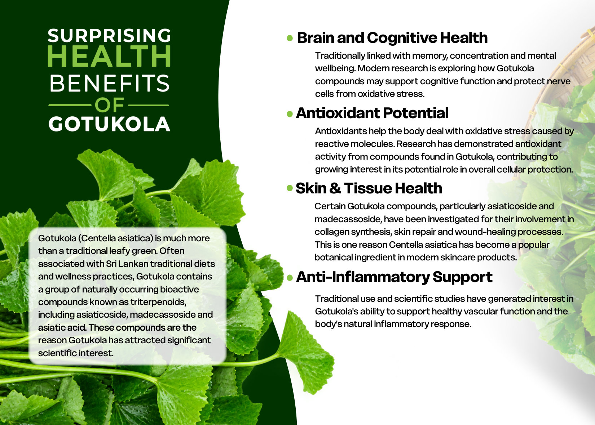

Gotukola (Centella asiatica) is much more than a traditional leafy green. Often associated with Sri Lankan traditional diets and wellness practices, Gotukola contains a group of naturally occurring bioactive compounds known as triterpenoids, including asiaticoside, madecassoside and asiatic acid. These compounds are the reason Gotukola has attracted significant scientific interest.

### Brain and Cognitive Health

Traditionally linked with memory, concentration and mental wellbeing. Modern research is exploring how Gotukola compounds may support cognitive function and protect nerve cells from oxidative stress.

### Antioxidant Potential

Antioxidants help the body deal with oxidative stress caused by reactive molecules. Research has demonstrated antioxidant activity from compounds found in Gotukola, contributing to growing interest in its potential role in overall cellular protection.

### Skin & Tissue Health

Certain Gotukola compounds, particularly asiaticoside and madecassoside, have been investigated for their involvement in collagen synthesis, skin repair and wound-healing processes. This is one reason Centella asiatica has become a popular botanical ingredient in modern skincare products.

### Anti-Inflammatory Support

Traditional use and scientific studies have generated interest in Gotukola's ability to support healthy vascular function and the body's natural inflammatory response.

---

## Page 14 — Why Is This Surprising?

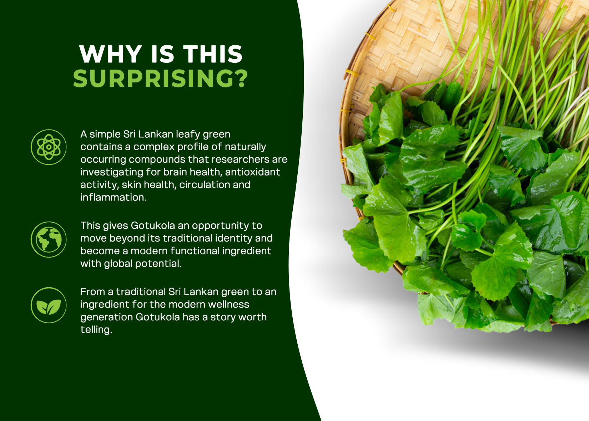

- A simple Sri Lankan leafy green contains a complex profile of naturally occurring compounds that researchers are investigating for brain health, antioxidant activity, skin health, circulation and inflammation.
- This gives Gotukola an opportunity to move beyond its traditional identity and become a modern functional ingredient with global potential.
- From a traditional Sri Lankan green to an ingredient for the modern wellness generation Gotukola has a story worth telling.

---

## Page 15 — Why We Use Gotukola

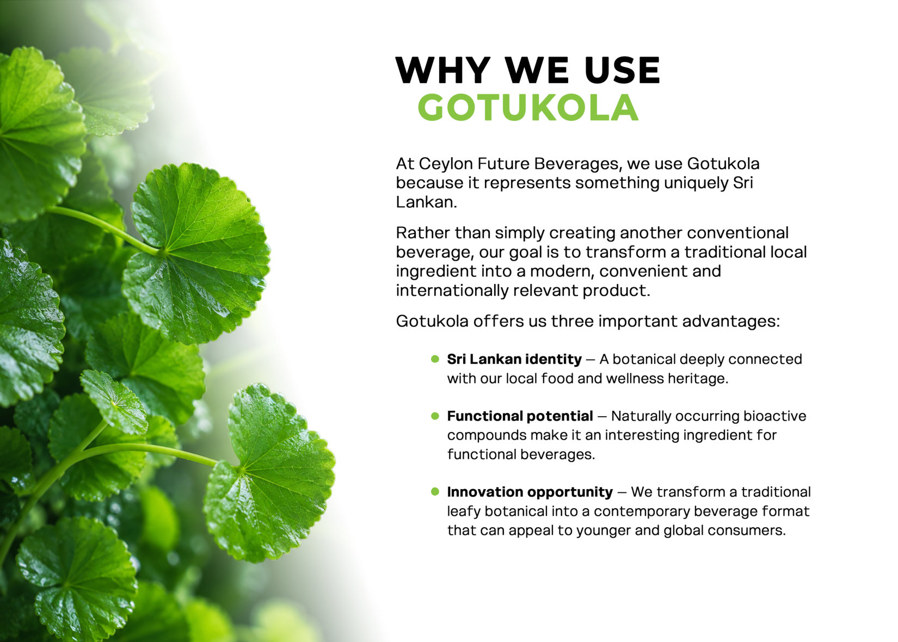

At Ceylon Future Beverages, we use Gotukola because it represents something uniquely Sri Lankan.

Rather than simply creating another conventional beverage, our goal is to transform a traditional local ingredient into a modern, convenient and internationally relevant product.

Gotukola offers us three important advantages:

- **Sri Lankan identity** — A botanical deeply connected with our local food and wellness heritage.
- **Functional potential** — Naturally occurring bioactive compounds make it an interesting ingredient for functional beverages.
- **Innovation opportunity** — We transform a traditional leafy botanical into a contemporary beverage format that can appeal to younger and global consumers.

---

## Page 16 — Certificate

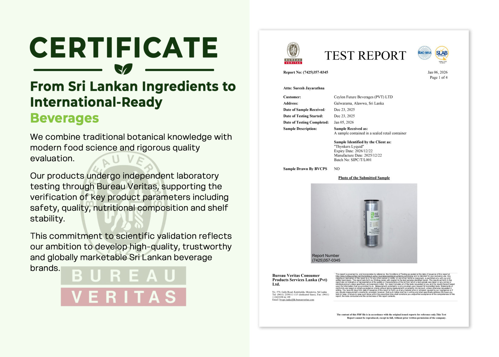

### Certificate

**From Sri Lankan Ingredients to International-Ready Beverages**

We combine traditional botanical knowledge with modern food science and rigorous quality evaluation.

Our products undergo independent laboratory testing through Bureau Veritas, supporting the verification of key product parameters including safety, quality, nutritional composition and shelf stability.

This commitment to scientific validation reflects our ambition to develop high-quality, trustworthy and globally marketable Sri Lankan beverage brands.

*(Bureau Veritas logo.)* The page also shows page 1 of Test Report (7425)357-0345, transcribed below.

---

## Pages 16–18 — Bureau Veritas Test Report No. (7425)357-0345 (Thynkers Lyquid)

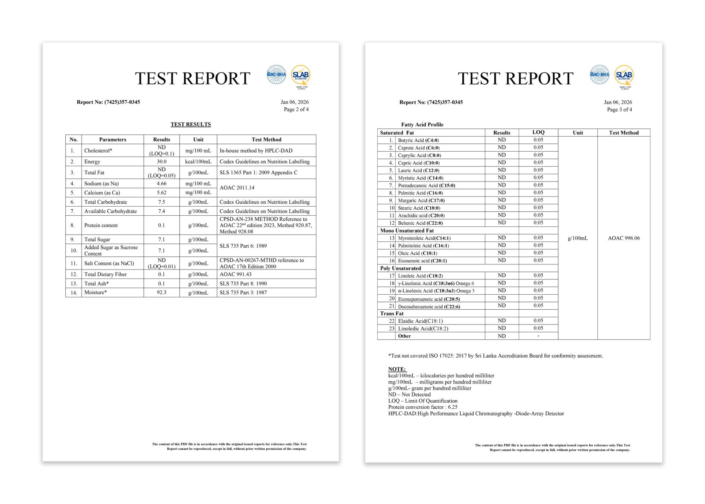

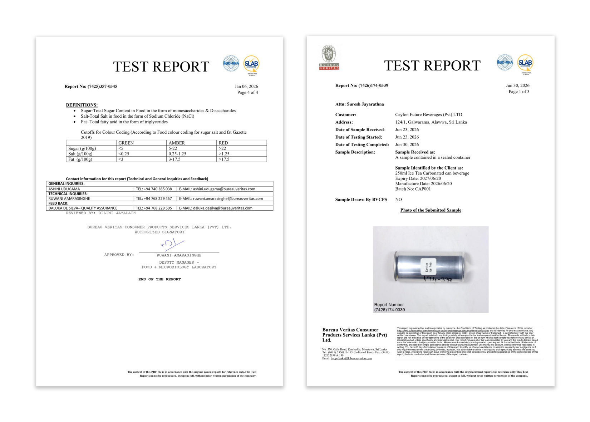

Accreditation marks: ilac-MRA, SLAB Accredited (ISO/IEC 17025, TL 055-01)

### Report page 1 of 4 — Jan 06, 2026

| Field | Value |
| --- | --- |
| Report No | (7425)357-0345 |
| Attn | Suresh Jayarathna |
| Customer | Ceylon Future Beverages (PVT) LTD |
| Address | Galwarama, Alawwa, Sri Lanka |
| Date of Sample Received | Dec 23, 2025 |
| Date of Testing Started | Dec 23, 2025 |
| Date of Testing Completed | Jan 05, 2026 |
| Sample Received as | A sample contained in a sealed retail container |
| Sample Identified by the Client as | "Thynkers Lyquid" |
| Expiry Date | 2026/12/22 |
| Manufacture Date | 2025/12/22 |
| Batch No | SIPC/T/L001 |
| Sample Drawn By BVCPS | NO |

Photo of the submitted sample: an unbranded silver can with a CFB sticker reading "Matcha Flavour", marked with Report Number (7425)357-0345.

**Bureau Veritas Consumer Products Services Lanka (Pvt) Ltd.**
No. 570, Galle Road, Katubedda, Moratuwa, Sri Lanka
Tel: (9411) 2350111-115 (dedicated lines), Fax: (9411) 112622198 & 199
Email: bvcps.lanka@lk.bureauveritas.com

> This report is governed by, and incorporates by reference, the Conditions of Testing as posted at the date of issuance of this report at http://www.bureauveritas.com/home/about-us/our-business/cps/about-us/terms-conditions/ and is intended for your exclusive use. Any copying or replication of this report to or for any other person or entity, or use of our name or trademark, is permitted only with our prior written permission. This report sets forth our findings solely with respect to the test samples identified herein. The results set forth in this report are not indicative or representative of the quality or characteristics of the lot from which a test sample was taken or any similar or identical product unless specifically and expressly noted. Our report includes all of the tests requested by you and the results thereof based upon the information that you provided to us. Measurement uncertainty is only provided upon request for accredited tests. Statements of conformity are based on simple acceptance criteria without taking measurement uncertainty into account, unless otherwise requested in writing. You have 60 days from date of issuance of this report to notify us of any material error or omission caused by our negligence or if you require measurement uncertainty; provided, however, that such notice shall be in writing and shall specifically address the issue you wish to raise. A failure to raise such issue within the prescribed time shall constitute you unqualified acceptance of the completeness of this report, the tests conducted and the correctness of the report contents.

### Report page 2 of 4 — Test Results

| No. | Parameters | Results | Unit | Test Method |
| --- | --- | --- | --- | --- |
| 1 | Cholesterol* | ND (LOQ=0.1) | mg/100 mL | In-house method by HPLC-DAD |
| 2 | Energy | 30.0 | kcal/100mL | Codex Guidelines on Nutrition Labelling |
| 3 | Total Fat | ND (LOQ=0.05) | g/100mL | SLS 1365 Part 1: 2009 Appendix C |
| 4 | Sodium (as Na) | 4.66 | mg/100 mL | AOAC 2011.14 |
| 5 | Calcium (as Ca) | 5.62 | mg/100 mL | AOAC 2011.14 |
| 6 | Total Carbohydrate | 7.5 | g/100mL | Codex Guidelines on Nutrition Labelling |
| 7 | Available Carbohydrate | 7.4 | g/100mL | Codex Guidelines on Nutrition Labelling |
| 8 | Protein content | 0.1 | g/100mL | CPSD-AN-238 METHOD Reference to AOAC 22nd edition 2023, Method 920.87, Method 928.08 |
| 9 | Total Sugar | 7.1 | g/100mL | SLS 735 Part 6: 1989 |
| 10 | Added Sugar as Sucrose Content | 7.1 | g/100mL | SLS 735 Part 6: 1989 |
| 11 | Salt Content (as NaCl) | ND (LOQ=0.01) | g/100mL | CPSD-AN-00267-MTHD reference to AOAC 17th Edition 2000 |
| 12 | Total Dietary Fiber | 0.1 | g/100mL | AOAC 991.43 |
| 13 | Total Ash* | 0.1 | g/100mL | SLS 735 Part 8: 1990 |
| 14 | Moisture* | 92.3 | g/100mL | SLS 735 Part 3: 1987 |

### Report page 3 of 4 — Fatty Acid Profile

Unit for all rows: g/100mL · Test method for all rows: AOAC 996.06

| No. | Fatty acid | Results | LOQ |
| --- | --- | --- | --- |
| | **Saturated Fat** | | |
| 1 | Butyric Acid (C4:0) | ND | 0.05 |
| 2 | Caproic Acid (C6:0) | ND | 0.05 |
| 3 | Caprylic Acid (C8:0) | ND | 0.05 |
| 4 | Capric Acid (C10:0) | ND | 0.05 |
| 5 | Lauric Acid (C12:0) | ND | 0.05 |
| 6 | Myristic Acid (C14:0) | ND | 0.05 |
| 7 | Pentadecanoic Acid (C15:0) | ND | 0.05 |
| 8 | Palmitic Acid (C16:0) | ND | 0.05 |
| 9 | Margaric Acid (C17:0) | ND | 0.05 |
| 10 | Stearic Acid (C18:0) | ND | 0.05 |
| 11 | Arachidic acid (C20:0) | ND | 0.05 |
| 12 | Behenic Acid (C22:0) | ND | 0.05 |
| | **Mono Unsaturated Fat** | | |
| 13 | Myroistoleic Acid (C14:1) | ND | 0.05 |
| 14 | Palmitoleic Acid (C16:1) | ND | 0.05 |
| 15 | Oleic Acid (C18:1) | ND | 0.05 |
| 16 | Eicosenoic acid (C20:1) | ND | 0.05 |
| | **Poly Unsaturated** | | |
| 17 | Linoleic Acid (C18:2) | ND | 0.05 |
| 18 | γ-Linolenic Acid (C18:3n6) Omega 6 | ND | 0.05 |
| 19 | α-Linolenic Acid (C18:3n3) Omega 3 | ND | 0.05 |
| 20 | Eicosapentaenoic acid (C20:5) | ND | 0.05 |
| 21 | Docosahexaenoic acid (C22:6) | ND | 0.05 |
| | **Trans Fat** | | |
| 22 | Elaidic Acid (C18:1) | ND | 0.05 |
| 23 | Linoledic Acid (C18:2) | ND | 0.05 |
| | Other | ND | – |

\*Test not covered ISO 17025: 2017 by Sri Lanka Accreditation Board for conformity assessment.

**Note:**
- kcal/100mL – kilocalories per hundred milliliter
- mg/100mL – milligrams per hundred milliliter
- g/100mL – gram per hundred milliliter
- ND – Not Detected
- LOQ – Limit Of Quantification
- Protein conversion factor: 6.25
- HPLC-DAD: High Performance Liquid Chromatography – Diode-Array Detector

### Report page 4 of 4

**Definitions:**
- Sugar – Total Sugar Content in Food in the form of monosaccharides & Disaccharides
- Salt – Total Salt in food in the form of Sodium Chloride (NaCl)
- Fat – Total fatty acid in the form of triglycerides

Cutoffs for Colour Coding (According to Food colour coding for sugar salt and fat Gazette 2019):

| | GREEN | AMBER | RED |
| --- | --- | --- | --- |
| Sugar (g/100g) | <5 | 5–22 | >22 |
| Salt (g/100g) | <0.25 | 0.25–1.25 | >1.25 |
| Fat (g/100g) | <3 | 3–17.5 | >17.5 |

Contact information for this report (Technical and General Inquiries and Feedback):

| Type | Name | Tel | E-mail |
| --- | --- | --- | --- |
| General inquiries | Ashini Udugama | +94 740 385 038 | ashini.udugama@bureauveritas.com |
| Technical inquiries | Ruwani Amarasinghe | +94 768 229 457 | ruwani.amarasinghe@bureauveritas.com |
| Feedback | Daluka De Silva – Quality Assurance | +94 768 229 505 | daluka.desilva@bureauveritas.com |

Reviewed by: Dilini Jayalath

Bureau Veritas Consumer Products Services Lanka (Pvt) Ltd. — Authorized Signatory
Approved by: Ruwani Amarasinghe, Deputy Manager – Food & Microbiology Laboratory *(signed)*

END OF THE REPORT

> The content of this PDF file is in accordance with the original issued reports for reference only. This Test Report cannot be reproduced, except in full, without prior written permission of the company.

---

## Pages 18–19 — Bureau Veritas Test Report No. (7426)174-0339 (Ceylon Ice Tea)

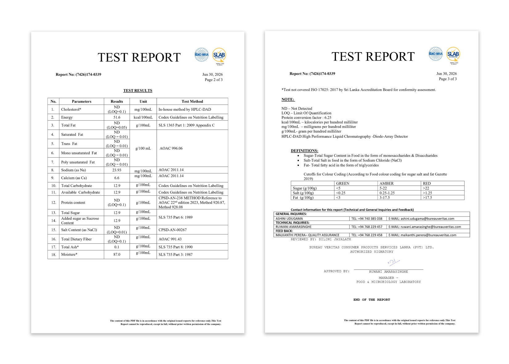

### Report page 1 of 3 — Jun 30, 2026

| Field | Value |
| --- | --- |
| Report No | (7426)174-0339 |
| Attn | Suresh Jayarathna |
| Customer | Ceylon Future Beverages (Pvt) LTD |
| Address | 124/1, Galwarama, Alawwa, Sri Lanka |
| Date of Sample Received | Jun 23, 2026 |
| Date of Testing Started | Jun 23, 2026 |
| Date of Testing Completed | Jun 30, 2026 |
| Sample Received as | A sample contained in a sealed container |
| Sample Identified by the Client as | 250ml Ice Tea Carbonated can beverage |
| Expiry Date | 2027/06/20 |
| Manufacture Date | 2026/06/20 |
| Batch No | CAP001 |
| Sample Drawn By BVCPS | NO |

Photo of the submitted sample: a silver can labelled "Ceylon Ice Tea", hand-marked "174-339", with Report Number (7426)174-0339.

Lab address and terms of testing are the same as report (7425)357-0345 above.

### Report page 2 of 3 — Test Results

| No. | Parameters | Results | Unit | Test Method |
| --- | --- | --- | --- | --- |
| 1 | Cholesterol* | ND (LOQ=0.1) | mg/100mL | In-house method by HPLC-DAD |
| 2 | Energy | 51.6 | kcal/100mL | Codex Guidelines on Nutrition Labelling |
| 3 | Total Fat | ND (LOQ=0.05) | g/100mL | SLS 1365 Part 1: 2009 Appendix C |
| 4 | Saturated Fat | ND (LOQ = 0.01) | g/100 mL | AOAC 996.06 |
| 5 | Trans Fat | ND (LOQ = 0.01) | g/100 mL | AOAC 996.06 |
| 6 | Mono unsaturated Fat | ND (LOQ = 0.01) | g/100 mL | AOAC 996.06 |
| 7 | Poly unsaturated Fat | ND (LOQ = 0.01) | g/100 mL | AOAC 996.06 |
| 8 | Sodium (as Na) | 23.93 | mg/100mL | AOAC 2011.14 |
| 9 | Calcium (as Ca) | 6.6 | mg/100mL | AOAC 2011.14 |
| 10 | Total Carbohydrate | 12.9 | g/100mL | Codex Guidelines on Nutrition Labelling |
| 11 | Available Carbohydrate | 12.9 | g/100mL | Codex Guidelines on Nutrition Labelling |
| 12 | Protein content | ND (LOQ=0.1) | g/100mL | CPSD-AN-238 METHOD Reference to AOAC 22nd edition 2023, Method 920.87, Method 928.08 |
| 13 | Total Sugar | 12.9 | g/100mL | SLS 735 Part 6: 1989 |
| 14 | Added sugar as Sucrose Content | 12.9 | g/100mL | SLS 735 Part 6: 1989 |
| 15 | Salt Content (as NaCl) | ND (LOQ=0.01) | g/100mL | CPSD-AN-00267 |
| 16 | Total Dietary Fiber | ND (LOQ=0.1) | g/100mL | AOAC 991.43 |
| 17 | Total Ash* | 0.1 | g/100mL | SLS 735 Part 8: 1990 |
| 18 | Moisture* | 87.0 | g/100mL | SLS 735 Part 3: 1987 |

### Report page 3 of 3

\*Test not covered ISO 17025: 2017 by Sri Lanka Accreditation Board for conformity assessment.

Notes, definitions and colour-coding cutoffs are the same as report (7425)357-0345 above.

Contact information for this report:

| Type | Name | Tel | E-mail |
| --- | --- | --- | --- |
| General inquiries | Ashini Udugama | +94 740 385 038 | ashini.udugama@bureauveritas.com |
| Technical inquiries | Ruwani Amarasinghe | +94 768 229 457 | ruwani.amarasinghe@bureauveritas.com |
| Feedback | Malkanthi Perera – Quality Assurance | +94 768 229 458 | malkanthi.perera@bureauveritas.com |

Reviewed by: Dilini Jayalath

Bureau Veritas Consumer Products Services Lanka (Pvt) Ltd. — Authorized Signatory
Approved by: Ruwani Amarasinghe, Manager – Food & Microbiology Laboratory *(signed)*

END OF THE REPORT

---

## Page 20 — From Ceylon to the World

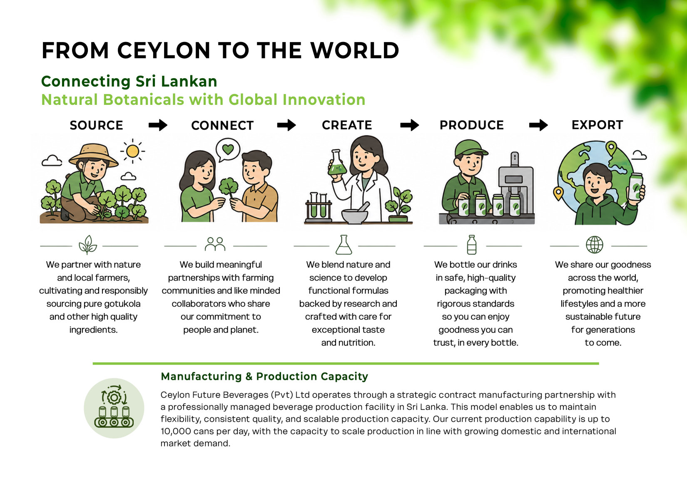

**Connecting Sri Lankan Natural Botanicals with Global Innovation**

**SOURCE → CONNECT → CREATE → PRODUCE → EXPORT**

| Step | Description |
| --- | --- |
| **Source** | We partner with nature and local farmers, cultivating and responsibly sourcing pure gotukola and other high quality ingredients. |
| **Connect** | We build meaningful partnerships with farming communities and like minded collaborators who share our commitment to people and planet. |
| **Create** | We blend nature and science to develop functional formulas backed by research and crafted with care for exceptional taste and nutrition. |
| **Produce** | We bottle our drinks in safe, high-quality packaging with rigorous standards so you can enjoy goodness you can trust, in every bottle. |
| **Export** | We share our goodness across the world, promoting healthier lifestyles and a more sustainable future for generations to come. |

### Manufacturing & Production Capacity

Ceylon Future Beverages (Pvt) Ltd operates through a strategic contract manufacturing partnership with a professionally managed beverage production facility in Sri Lanka. This model enables us to maintain flexibility, consistent quality, and scalable production capacity. Our current production capability is up to **10,000 cans per day**, with the capacity to scale production in line with growing domestic and international market demand.

---

## Page 21 — Shipping Arrangement

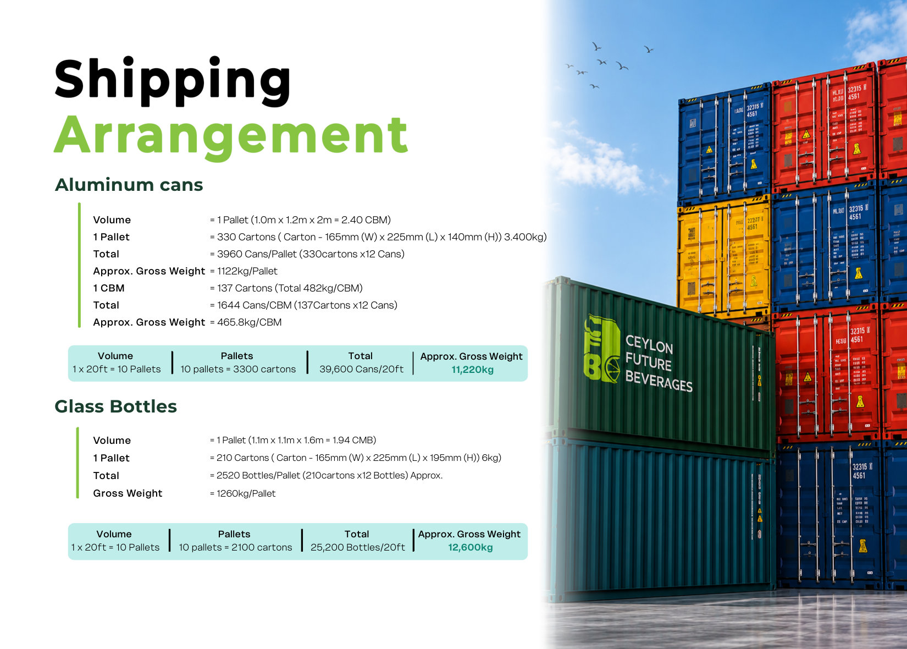

### Aluminum cans

| Item | Value |
| --- | --- |
| Volume | 1 Pallet (1.0m x 1.2m x 2m = 2.40 CBM) |
| 1 Pallet | 330 Cartons (Carton – 165mm (W) x 225mm (L) x 140mm (H)) 3.400kg) |
| Total | 3960 Cans/Pallet (330 cartons x 12 Cans) |
| Approx. Gross Weight | 1122kg/Pallet |
| 1 CBM | 137 Cartons (Total 482kg/CBM) |
| Total | 1644 Cans/CBM (137 Cartons x 12 Cans) |
| Approx. Gross Weight | 465.8kg/CBM |

| Volume | Pallets | Total | Approx. Gross Weight |
| --- | --- | --- | --- |
| 1 x 20ft = 10 Pallets | 10 pallets = 3300 cartons | 39,600 Cans/20ft | **11,220kg** |

### Glass Bottles

| Item | Value |
| --- | --- |
| Volume | 1 Pallet (1.1m x 1.1m x 1.6m = 1.94 CMB) |
| 1 Pallet | 210 Cartons (Carton – 165mm (W) x 225mm (L) x 195mm (H)) 6kg) |
| Total | 2520 Bottles/Pallet (210 cartons x 12 Bottles) Approx. |
| Gross Weight | 1260kg/Pallet |

| Volume | Pallets | Total | Approx. Gross Weight |
| --- | --- | --- | --- |
| 1 x 20ft = 10 Pallets | 10 pallets = 2100 cartons | 25,200 Bottles/20ft | **12,600kg** |

*Image: stacked shipping containers, one green container branded CEYLON FUTURE BEVERAGES.*

---

## Page 22 — Outlets

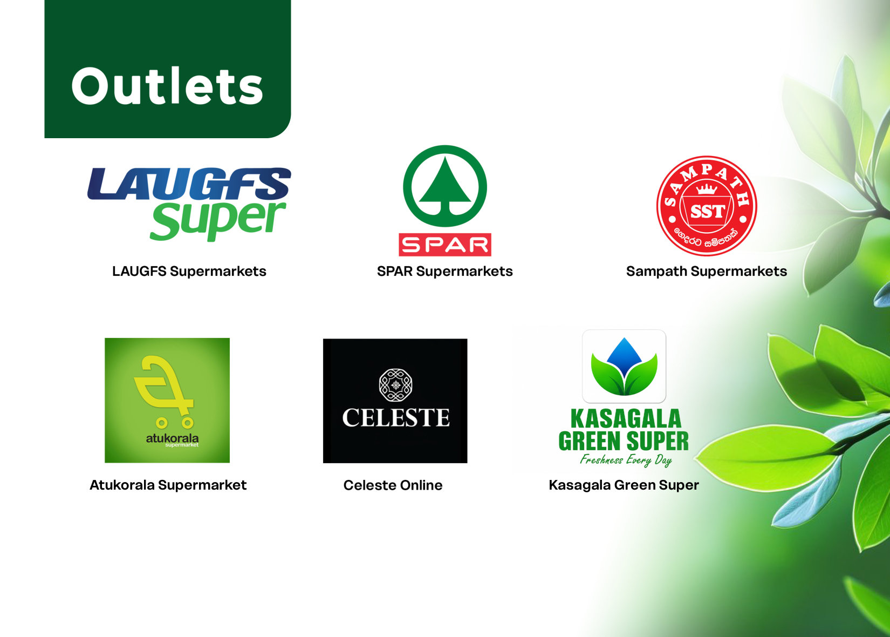

- LAUGFS Supermarkets
- SPAR Supermarkets
- Sampath Supermarkets
- Atukorala Supermarket
- Celeste Online
- Kasagala Green Super
- Uptown Kandy
- CEC Agromart Nawala
- Surapathi Negombo
- Rathnayaka super giriulla
- Odera Hypermarket Mawanella

---

## Page 23 — Back Cover / Contact

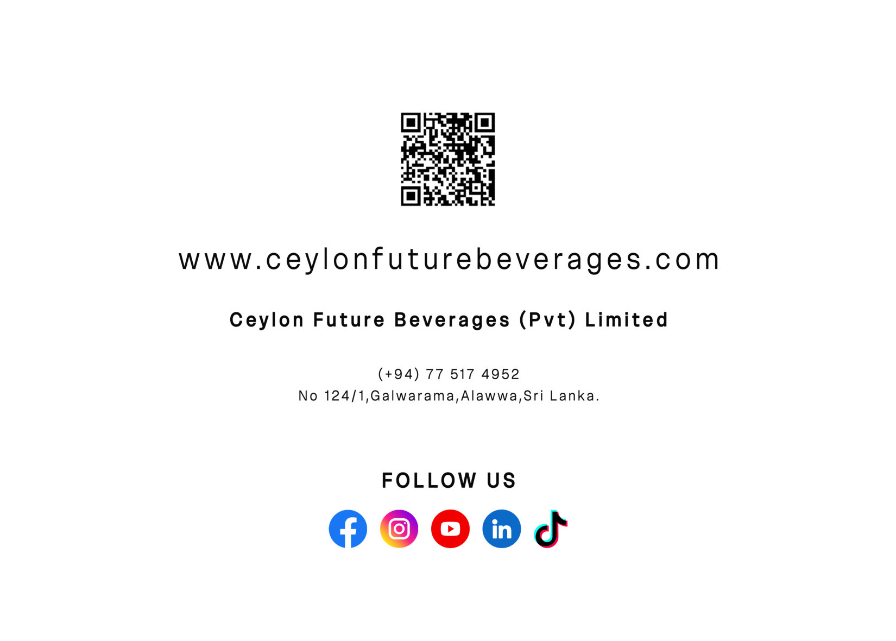

*(QR code)*

**www.ceylonfuturebeverages.com**

**Ceylon Future Beverages (Pvt) Limited**

(+94) 77 517 4952
No 124/1, Galwarama, Alawwa, Sri Lanka.

**FOLLOW US:** Facebook · Instagram · YouTube · LinkedIn · TikTok
